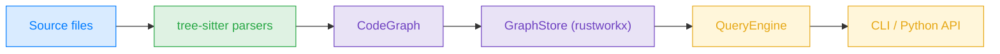
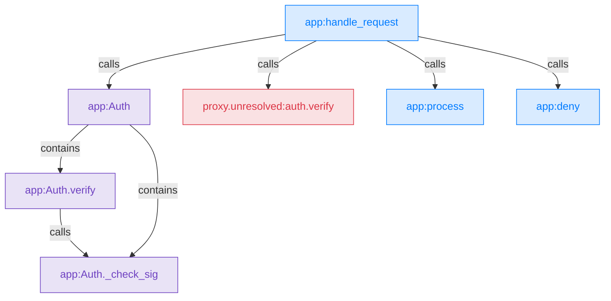

# Trailmark

[](https://github.com/trailofbits/trailmark/actions/workflows/ci.yml)
[](https://github.com/trailofbits/trailmark/actions/workflows/mutation.yml)

Trailmark parses source code into a graph of functions, types, calls, and
other relationships, then lets you ask structural questions about it:

- Which entrypoints can reach this function, and along which call paths?
- What changed in the attack surface between two commits?
- Which functions write this Solidity storage variable?
- Where did call resolution stop, so that reachability results are incomplete?

It supports 31 languages through [tree-sitter](https://tree-sitter.github.io/),
stores the graph in [rustworkx](https://www.rustworkx.org/), and exposes it
through a command-line tool and a Python API. Trailmark was built for security
review: every edge records whether it came straight from syntax or from a
heuristic, and calls it could not resolve stay in the graph.

The long-term vision is to combine this graph with mutation testing and
coverage-guided fuzzing to identify gaps between assumptions and test coverage
that are reachable from user input.

## Features

- **Code graphs.** Functions, methods, classes, structs, traits, contracts, and
  modules, connected by calls, inheritance, containment, and type use.
  `--language auto` merges every supported language in a tree into one graph.
- **Attack surface.** Framework-aware entrypoint detection (Flask, FastAPI,
  Spring, ASP.NET Core, actix-web, NestJS, Solidity visibility, and more), each
  tagged with a trust level and asset value. Override or extend detection with
  `.trailmark/entrypoints.toml`.
- **Reachability.** Direct callers and callees, transitive slices, and bounded
  call paths from entrypoints to a target.
- **Structural diffs.** Compare two directories or git refs and report added or
  removed functions, call edges, and entrypoints.
- **Diagrams.** Mermaid call graphs, class hierarchies, module dependencies,
  containment views, complexity maps, and entrypoint-to-target flows.
- **Findings on the graph.** Import SARIF and weAudit results, attach your own
  annotations, and run preanalysis passes (blast radius, privilege boundaries,
  coarse taint) that store their results as annotations and named subgraphs.
- **Visible gaps.** Calls that cannot be resolved become proxy nodes instead of
  disappearing, and `trailmark analyze --resolution` counts them.
- **Links Trailmark cannot see.** Declare RPC, FFI, and subprocess edges in
  `.trailmark/links.toml`, or import a call graph produced by a binary-analysis
  tool.
- **Solidity storage access.** `reads` and `writes` edges between functions and
  the contract state variables they touch.

## Install

```bash
uv tool install trailmark        # the CLI
uv add trailmark                 # the library, in a uv-managed project
```

Requires Python &ge; 3.12. CI tests Python 3.12 through 3.15.
With Nix, `nix run github:trailofbits/trailmark` runs the CLI directly.

This README and the guides track the `main` branch. The
[changelog](https://github.com/trailofbits/trailmark/blob/main/CHANGELOG.md)
lists what each published release includes, and the CLI and Python API guides
note the version that added each newer feature.

Most grammars are downloaded and cached on first use. The bundled Circom, Miden
Assembly, and Verus grammars are compiled on first use, which needs a C
compiler. See [Installation](https://github.com/trailofbits/trailmark/blob/main/docs/installation.md)
for offline machines, TLS-inspecting proxies, and building from a checkout.

## Quick start

```bash
# Node and edge counts for a Python project (Python is the default language)
trailmark analyze --summary path/to/project

# The same summary as JSON, including source-file counts per language (v0.7+)
trailmark analyze --summary --json --language auto path/to/project

# Full JSON graph of every supported language in the tree
trailmark analyze --language auto path/to/project > graph.json

# Detected entrypoints with trust level and asset value
trailmark entrypoints --language auto path/to/project

# How the attack surface changed between two git refs
trailmark diff --repo . main HEAD

# Mermaid call graph around one function
trailmark diagram -t path/to/project -T call-graph -f handle_request

# How many call sites could not be resolved, grouped by callee name
trailmark analyze --language rust --resolution path/to/project
```

Directory analysis rejects missing roots and zero matching source files. The
summary includes selected languages and inspected file counts; use
`--allow-empty` for an intentional empty input.
Graph JSON includes the exporting Trailmark version and an export schema version
(v0.7+); compare snapshots built with the same Trailmark version and languages.

The same questions from Python:

```python
from trailmark.query.api import QueryEngine

engine = QueryEngine.from_directory("path/to/project", language="auto")

engine.attack_surface()                    # entrypoints and their trust levels
engine.callers_of("verify_signature")      # direct callers
engine.ancestors_of("verify_signature")    # everything that can reach it
engine.entrypoint_paths_to("verify_signature")
engine.complexity_hotspots(10)             # cyclomatic complexity >= 10
```

Names can be bare (`verify_signature`), qualified (`Auth.verify`), or full node
IDs (`auth:Auth.verify`). Query results are plain dicts and lists that serialize
directly to JSON.

## How it works



1. **Parse.** A parser for each language walks the directory and extracts nodes
   (functions, types, modules), edges (calls, inheritance, containment, and so on),
   and metadata (parameters, return types, branches, cyclomatic complexity,
   docstrings, raised exceptions). A linking pass then resolves calls across
   files, links types to their declarations, and applies `.trailmark/links.toml`.
2. **Index.** `GraphStore` loads the graph into a rustworkx directed graph for
   fast traversal. `QueryEngine.from_directory()` also runs entrypoint detection.
3. **Query.** `QueryEngine` resolves names to node IDs, runs traversals, and
   returns JSON-serializable results.

### Example

Given `app.py`:

```python
class Auth:
    def verify(self, token):
        return self._check_sig(token)

    def _check_sig(self, token): ...


def handle_request(req):
    auth = Auth()
    if auth.verify(req.token):
        return process(req)
    return deny()


def process(req): ...
def deny(): ...
```

Trailmark produces this graph (module containment edges omitted):



`self._check_sig(...)` resolves because `self` names the enclosing class.
`auth.verify(...)` does not, because Trailmark does not infer that the local
variable `auth` holds an `Auth`. The call is kept as a proxy node rather than
dropped. As a result, `engine.ancestors_of("Auth._check_sig")` returns only
`app:Auth.verify`, and `engine.unresolved_calls("handle_request")` shows the
exact call site where the path was lost. See
[Graph model](https://github.com/trailofbits/trailmark/blob/main/docs/graph-model.md)
for every node kind, edge kind, and ID rule, and
[Call resolution](https://github.com/trailofbits/trailmark/blob/main/docs/call-resolution.md)
for working with proxies.

## Supported languages

| Language | Extensions | `--language` | Extracts |
| --- | --- | --- | --- |
| Python | `.py` | `python` | functions, classes, methods |
| JavaScript | `.js`, `.jsx`, `.mjs`, `.cjs` | `javascript` | functions, classes, arrow functions |
| TypeScript | `.ts`, `.tsx` | `typescript` | functions, classes, interfaces, enums |
| PHP | `.php` | `php` | functions, classes, interfaces, traits |
| Ruby | `.rb` | `ruby` | methods, classes, modules |
| C | `.c`, `.h` | `c` | functions, structs, enums |
| C++ | `.cpp`, `.cc`, `.cxx`, `.hpp`, `.hh`, `.hxx` | `cpp` | functions, classes, structs, namespaces |
| C# | `.cs` | `c_sharp` | methods, classes, interfaces, structs, enums, namespaces |
| Java | `.java` | `java` | methods, classes, interfaces, enums |
| Go | `.go` | `go` | functions, methods, structs, interfaces |
| Rust | `.rs` | `rust` | functions, structs, traits, enums, impl blocks, `verus!` blocks |
| Solidity | `.sol` | `solidity` | contracts, interfaces, libraries, functions, modifiers, structs, enums, state variables |
| Cairo | `.cairo` | `cairo` | functions, traits, structs, enums, impl blocks, StarkNet contracts |
| Circom | `.circom` | `circom` | templates, functions, signals, components |
| Haskell | `.hs` | `haskell` | functions, data types, type classes, instances |
| Erlang | `.erl` | `erlang` | functions, records, behaviours, modules |
| Miden Assembly | `.masm` | `masm` | procedures, entrypoints, constants, invocations |
| Swift | `.swift` | `swift` | functions, classes, structs, enums, protocols, extensions |
| Objective-C | `.m`, `.mm`, `.h` | `objc` | C functions, classes, methods (selector-based naming) |
| Kotlin | `.kt`, `.kts` | `kotlin` | functions, classes, interfaces, data classes, objects, methods |
| Dart | `.dart` | `dart` | functions, classes, abstract classes, methods, constructors |
| Move | `.move` | `move` | modules, functions, imports, direct calls |
| Tact | `.tact` | `tact` | contracts, structs, receivers, functions |
| Func | `.fc`, `.func` | `func` | functions, includes, direct calls |
| Sway | `.sw` | `sway` | ABI interfaces, structs, impl methods, functions |
| Zig | `.zig` | `zig` | Functions, named structs/enums/unions, container methods, imports, direct calls |
| Rego | `.rego` | `rego` | packages, imports, policy rules, rule calls |
| Proto | `.proto` | `proto` | services, RPCs, messages, fields, enums |
| Thrift | `.thrift` | `thrift` | services, functions, structs, fields, enums |
| GraphQL | `.graphql`, `.gql` | `graphql` | object types, root operations, fields, enums |
| SQL | `.sql` | `sql` | schemas, tables, views, functions, procedures |

Pass `--language auto` to detect languages, or a comma-separated list such as
`--language python,rust`. [Language notes](https://github.com/trailofbits/trailmark/blob/main/docs/languages.md)
covers Rust and Verus scoping, Solidity storage access, header handling, and
other per-language behavior.

## Documentation

| Guide | What it covers |
| --- | --- |
| [CLI reference](https://github.com/trailofbits/trailmark/blob/main/docs/cli.md) | Every subcommand, flag, and output format |
| [Python API](https://github.com/trailofbits/trailmark/blob/main/docs/python-api.md) | `QueryEngine` methods, name lookup, path queries, the parse-only API |
| [Graph model](https://github.com/trailofbits/trailmark/blob/main/docs/graph-model.md) | Node and edge kinds, confidence, node IDs, proxies, directory walking |
| [Entrypoints](https://github.com/trailofbits/trailmark/blob/main/docs/entrypoints.md) | Detection layers, framework coverage, `.trailmark/entrypoints.toml` |
| [Cross-language links](https://github.com/trailofbits/trailmark/blob/main/docs/links.md) | `.trailmark/links.toml` for RPC, FFI, and external edges |
| [Findings and preanalysis](https://github.com/trailofbits/trailmark/blob/main/docs/augmenting.md) | SARIF, weAudit, binary call graphs, annotations, preanalysis passes |
| [Call resolution](https://github.com/trailofbits/trailmark/blob/main/docs/call-resolution.md) | Measuring unresolved calls and what they mean for reachability |
| [Language notes](https://github.com/trailofbits/trailmark/blob/main/docs/languages.md) | Rust and Verus, Solidity state, TypeScript, SQL, C-family headers |
| [Installation](https://github.com/trailofbits/trailmark/blob/main/docs/installation.md) | Grammar caches, offline installs, bundled grammars, Nix, checkouts |
| [Changelog](https://github.com/trailofbits/trailmark/blob/main/CHANGELOG.md) | What changed in each release |

## Agent skills

The [Trailmark plugin](https://github.com/trailofbits/skills/tree/main/plugins/trailmark)
packages Trailmark workflows as agent skills, including call-graph
summaries, diagram generation, finding triage, and differential review.

## Limitations

Trailmark builds its graph from syntax and naming. It does not compile code, so:

- Paths are call-graph reachability, not attacker-controlled data flow.
  Preanalysis taint is a coarse, separate signal.
- Dynamic dispatch, overloads that need argument types, and calls through
  receivers whose type would have to be inferred stay unresolved.
- Macros are not expanded, and implicit calls such as destructors produce no
  edges.
- A missing edge is not proof that a call or storage access cannot happen.

Each guide lists the limits specific to its feature.

## Contributing

See [CONTRIBUTING.md](https://github.com/trailofbits/trailmark/blob/main/CONTRIBUTING.md)
for setup, checks, mutation testing, and how to add a language parser.

## License

Apache-2.0
