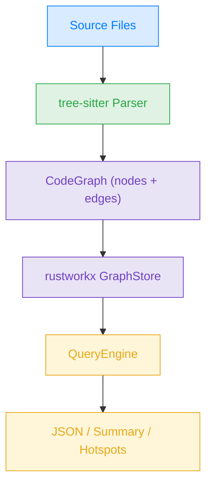
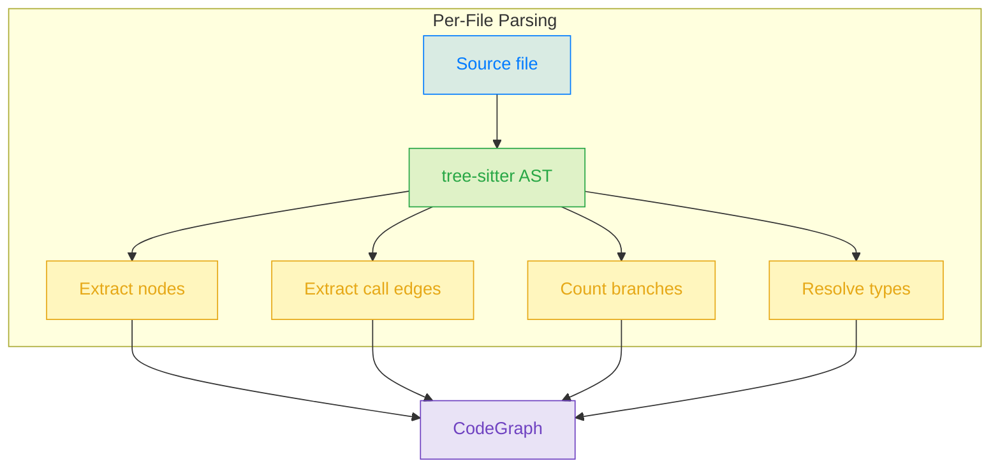
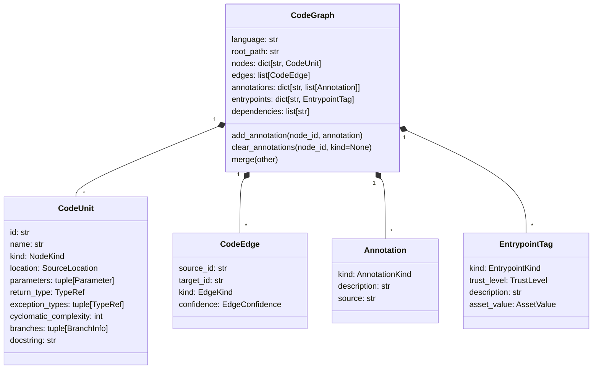
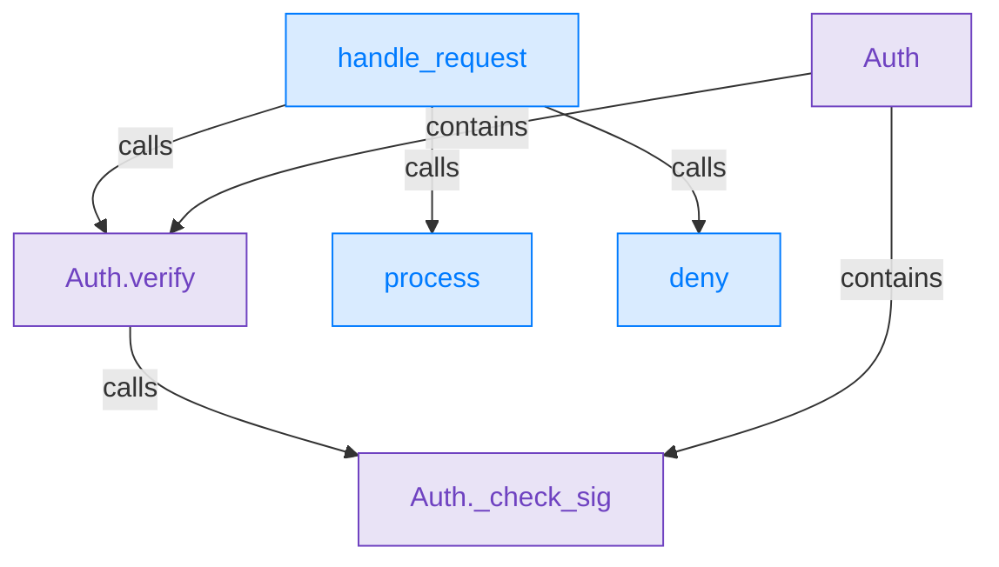

# Trailmark

[](https://github.com/trailofbits/trailmark/actions/workflows/ci.yml)
[](https://github.com/trailofbits/trailmark/actions/workflows/mutation.yml)

Parse source code into queryable graphs of functions, classes, calls, and semantic annotations for security analysis.

Trailmark uses [tree-sitter](https://tree-sitter.github.io/) for language-agnostic AST parsing and [rustworkx](https://www.rustworkx.org/) for high-performance graph traversal. The long-term vision is to combine this graph with mutation testing and coverage-guided fuzzing to identify gaps between assumptions and test coverage that are reachable from user input.

## How It Works

Trailmark operates in three phases: **parse**, **index**, and **query**.



### 1. Parse

A language-specific parser walks the directory, parses each file into a tree-sitter AST, and extracts:

- **Nodes** &mdash; functions, methods, classes, structs, interfaces, traits, enums, modules, namespaces
- **Edges** &mdash; calls, inheritance, implementation, containment, imports
- **Metadata** &mdash; type annotations, cyclomatic complexity, branches, docstrings, exception types

### Supported Languages

| Language | Extensions | Key constructs |
| --- | --- | --- |
| Python | `.py` | functions, classes, methods |
| JavaScript | `.js`, `.jsx`, `.mjs`, `.cjs` | functions, classes, arrow functions |
| TypeScript | `.ts`, `.tsx` | functions, classes, interfaces, enums |
| PHP | `.php` | functions, classes, interfaces, traits |
| Ruby | `.rb` | methods, classes, modules |
| C | `.c`, `.h` | functions, structs, enums |
| C++ | `.cpp`, `.hpp`, `.cc`, `.hh`, `.cxx`, `.hxx` | functions, classes, structs, namespaces |
| C# | `.cs` | methods, classes, interfaces, structs, enums, namespaces |
| Java | `.java` | methods, classes, interfaces, enums |
| Go | `.go` | functions, methods, structs, interfaces |
| Rust | `.rs` | functions, structs, traits, enums, impl blocks, `verus!` blocks |
| Solidity | `.sol` | contracts, interfaces, libraries, functions, modifiers, structs, enums |
| Cairo | `.cairo` | functions, traits, structs, enums, impl blocks, StarkNet contracts |
| Circom | `.circom` | templates, functions, signals, components |
| Haskell | `.hs` | functions, data types, type classes, instances |
| Erlang | `.erl` | functions, records, behaviours, modules |
| Miden Assembly | `.masm` | procedures, entrypoints, constants, invocations |
| Swift | `.swift` | functions, classes, structs, enums, protocols, extensions |
| Objective-C | `.m`, `.mm`, `.h` | C functions, classes, methods (selector-based naming) |
| Kotlin | `.kt`, `.kts` | functions, classes, interfaces, data classes, objects, methods |
| Dart | `.dart` | functions, classes, abstract classes, methods, constructors |
| Move | `.move` | modules, functions, imports, direct calls |
| Tact | `.tact` | contracts, structs, receivers, functions |
| Func | `.fc`, `.func` | functions, includes, direct calls |
| Sway | `.sw` | ABI interfaces, structs, impl methods, functions |
| Rego | `.rego` | packages, imports, policy rules, rule calls |
| Proto | `.proto` | services, RPCs, messages, fields, enums |
| Thrift | `.thrift` | services, functions, structs, fields, enums |
| GraphQL | `.graphql`, `.gql` | object types, root operations, fields, enums |
| SQL | `.sql` | schemas, tables, views, functions, procedures |

The Rust parser extracts ordinary, `spec`, and `proof` functions with bodies
from `verus! { ... }` blocks. The Verus grammar currently supports only
brace-delimited blocks; `verus!(...)` and `verus![...]` are skipped with a warning.
Inline modules retain qualified IDs (for example, `file.inner:function`), and
methods retain their impl or trait owner. Each block is parsed independently;
syntax errors produce a warning with the file and block location.
Qualified invocations such as `vstd::prelude::verus!` are supported too.
Local helper functions retain their enclosing function in their IDs (for example,
`file:outer.inner`). Calls to these helpers and relative imports such as
`use super::*` resolve to declarations present in the file.
Repeated local names in different blocks receive a byte-offset suffix to keep
their nodes distinct, and calls respect block scope.
Local structs, enums, traits, and inline modules retain the enclosing function
too: for example, `file:outer.Guard.drop` and `file:outer.local.helper`.
Their bodies have separate calls and complexity. Explicit calls to known local
types and modules resolve within the file. Bare calls search function and module
scopes; associated items use paths such as `Type::method`. Dotted calls resolve
only when the receiver names a known struct or enum. Other value receivers,
including `self.method()`, remain unresolved. Implicit destructor calls and receiver
type inference are not modeled. These rules apply to ordinary Rust as well as
Verus blocks. Editing code before a declaration with an offset suffix changes
its ID, so `trailmark diff` can report that declaration as removed and added.

Trailmark does not expand arbitrary macros. Literal Verus invocations inside
opaque macros or function bodies are skipped with a warning. Uninvoked
`macro_rules!` definitions are not expanded. Function signatures without bodies
and calls in `requires`/`ensures` clauses are not extracted.
See [call-resolution diagnostics](#call-resolution-diagnostics) for inspecting
unresolved Rust calls and the limits of reachability through them.



Node IDs follow the scheme `module:function`, `module:Class`, or `module:Class.method` for unambiguous lookup. Directory parsing resolves bare cross-file calls when a unique definition exists; ambiguous cross-file calls are left at their original best-effort target and marked `uncertain`. Edge confidence is tagged as `certain` (direct calls, `self.method()`), `inferred` (attribute access on non-self objects), or `uncertain` (dynamic dispatch or ambiguous resolution).

### 2. Index

The `GraphStore` loads the `CodeGraph` into a rustworkx `PyDiGraph` and builds bidirectional ID/index mappings for fast traversal.

### 3. Query

The `QueryEngine` provides a high-level API over the indexed graph:

| Method | Description |
| --- | --- |
| `callers_of(name)` | Direct callers of the named target |
| `callees_of(name)` | Direct callees of the named source |
| `ancestors_of(name)` | Every function that can transitively reach the target (upward slice) |
| `reachable_from(name)` | Every function transitively reachable from the source |
| `paths_between(src, dst)` | All simple call paths between two nodes |
| `connect_subgraphs(source, target)` | Paths connecting two named subgraphs |
| `entrypoint_paths_to(name)` | Paths from any detected entrypoint to the target |
| `attack_surface()` | Entrypoints tagged with trust level, asset value, and parser attributes when present |
| `complexity_hotspots(n)` | Functions with cyclomatic complexity &ge; n |
| `functions_that_raise(exc)` | Functions whose parser-detected exception list includes `exc` |
| `generic_parameters(name)` | Generic type parameters declared by a node |
| `type_references(name)` | Parameter, return, exception, and generic-bound type references |
| `annotate(name, kind, description, source)` | Add a semantic annotation to a node |
| `annotations_of(name, kind=None)` | Get annotations for a node, optionally filtered by kind |
| `nodes_with_annotation(kind)` | Every node tagged with the given annotation kind |
| `clear_annotations(name, kind=None)` | Remove annotations from a node |
| `diff_against(other)` | Structural diff of this engine's graph vs. another |
| `preanalysis()` | Run the built-in pre-analysis passes and store annotations/subgraphs |
| `augment_sarif(path)` | Merge SARIF findings into the graph |
| `augment_weaudit(path)` | Merge weAudit findings into the graph |
| `augment_binary(path)` | Merge an external binary-analysis graph JSON file |
| `findings(kind=None)` | Return nodes carrying finding-style annotations |
| `subgraph(name)` | Return the nodes in a named subgraph |
| `subgraph_edges(name)` | Return induced edges inside a named subgraph |
| `subgraph_names()` | List every named subgraph currently on the graph |
| `summary()` | Node counts, edge counts, dependencies |
| `unresolved_calls(name=None)` | Unresolved call sites, optionally restricted to one caller, with raw expressions and locations |
| `call_resolution()` | Extracted call-site counts and unresolved calls grouped by callee label |
| `to_json()` | Full graph export |

### Data Model



**Node kinds:** `function`, `method`, `class`, `module`, `struct`, `interface`, `trait`, `enum`, `namespace`, `contract`, `library`, `template`, `proxy`

**Node origins:** `source`, `proxy`, `binary`, `synthetic`

**Edge kinds:** `calls`, `inherits`, `implements`, `contains`, `imports`, `resolves_to`, `type_uses`, `specializes`, `corresponds_to`

**Edge confidence:** `certain`, `inferred`, `uncertain`

Unresolved calls are materialized as proxy nodes such as
`proxy.unresolved:<raw-symbol>` so traversal results can show where source
analysis lost resolution instead of silently dropping that edge. Directory
parses, including single-language parses, also apply repository links and
materialize `TYPE_USES` edges. Binary analysis support imports external JSON
call graphs; Trailmark does not disassemble executables itself.

### Example Graph

Given this Python code:

```python
class Auth:
    def verify(self, token: str) -> bool:
        return self._check_sig(token)

    def _check_sig(self, token: str) -> bool:
        ...

def handle_request(req: Request) -> Response:
    auth = Auth()
    if auth.verify(req.token):
        return process(req)
    return deny()
```

Trailmark produces a graph like:



### Call-Resolution Diagnostics

```bash
trailmark analyze --language rust --resolution path/to/project
```

The JSON report distinguishes `call_sites`, `resolved_call_sites`,
`unresolved_call_sites`, `unresolved_targets` (distinct proxy IDs), and
`affected_callers`. `unresolved_by_callee` groups calls by their final syntactic
name, such as `unwrap` or `expect`, and sorts groups by descending call-site
count, then name. These labels do not identify a particular trait implementation.
Repeated calls to the same proxy count as separate sites. Explicitly linked
external proxies are not classified as unresolved.

For detailed inspection, use the Python API:

```python
engine = QueryEngine.from_directory("./project", language="rust")
engine.call_resolution()
engine.unresolved_calls()         # every unresolved call site
engine.unresolved_calls("handle") # only calls made directly by this function
```

Each row includes the caller (`source`), proxy ID (`target`), `raw_target`,
`callee`, confidence, and the individual call's `location` (or `None` when
unavailable). A proxy node's own location represents its first occurrence;
use call-site locations when examining repeated calls. A missing caller returns
`[]`. The reports also work for other supported languages.

Rust resolution currently has these limits:

| Pattern | Behavior |
| --- | --- |
| Standard methods: `.unwrap()`, `.expect()`, `.clone()`, `.len()` | Calls are retained; receiver types and dependency implementations are not inferred |
| Iterator chains: `.iter().map(...).collect()` | Each syntactic call is retained; intermediate result types are not propagated |
| Trait conversions: `.into()`, `.try_into()`, `TokenId::try_from()` | Trait implementations and generated methods may remain unresolved |
| External calls: `UdpSocket::bind()`, `prost_build::Config::new()` | Dependency source and compiler resolution are not loaded automatically |
| Generated builders: `Action::builder().timestamp(...)` | Calls are retained; arbitrary macro expansion does not generate their implementations |
| Local value receivers: `engine.execute()`, `self.side.converse()` | Receiver types are not inferred, even from explicit parameter annotations |
| Enum constructors: `ActionKind::Deposit(1)`, `Ok(...)`, `Err(...)` | Parenthesized constructors are retained as calls and can remain proxies; a bare variant value is not a call |

Declared return types are recorded as metadata, but they do not resolve later
calls on returned values. For example, `make() -> Result<Engine, ()>` does not
link `make().unwrap().execute()` to `Engine.execute`. Calls to `make`, `unwrap`,
and `execute` are recorded separately; recording them does not establish the
receiver's type or the callee's implementation.

Unresolved proxies retain the boundary where resolution stops. Reachability and
preanalysis cannot follow a missing implementation beyond that boundary, so
local effects may be absent from the resulting paths. Thousands of proxies
alone do not show that the corresponding call expressions were dropped.
Review the affected callers and supply reviewed missing call edges through
`.trailmark/links.toml`, or import an externally produced graph with
`augment_binary()` when appropriate.

The report measures resolution of extracted calls, not overall program
coverage. Opaque macro bodies and implicit calls may produce no edges and are
outside its counts. Zero unresolved calls is not proof that the graph contains
every executable path. Hiding common proxy names does not restore those paths.

## Installation

The examples below track the current development branch. For the latest
published package, install from PyPI. For the exact feature set described
here, install from a checkout and run commands via `uv run`.

```bash
# Latest published release
uv pip install trailmark

# Current checkout / development branch
uv sync --all-groups
```

Requires Python &ge; 3.12.

Trailmark requires `tree-sitter-language-pack` 1.22.1 or newer for most grammars.
Root-owned grammar caches are supported when they are not group- or other-writable.
Current releases use the platform certificate store for grammar downloads. In
TLS-inspected or offline environments, pre-populate the package cache with
`python -c "import tree_sitter_language_pack as p; p.download_all()"` on a
matching platform, then copy the resulting `tree-sitter-language-pack` cache
directory to the target machine. `HTTPS_PROXY` is also honored. The SQL grammar
ships as the `tree-sitter-sql` wheel dependency and does not use that cache.

The bundled Circom, Miden Assembly, and Verus grammars compile on first use.
This requires a C compiler (`cc`), Python development headers, and write access
to their installed grammar directories. Rust files without Verus blocks do not
trigger compilation. If the Verus grammar cannot be built or loaded, Trailmark
logs a warning, skips Verus blocks, and continues parsing ordinary Rust.
The Verus binding cache includes the compiled source contents, Python ABI,
platform, and compiler options. Changed inputs select a new binding; completed
builds are published atomically. Compiler failures include the exit status and
stderr in the warning.

Git checkouts keep the Verus grammar definition and generate its C parser during
builds with Tree-sitter CLI 0.27.1. Before `uv sync` or `uv build` in a checkout,
run `npm ci` with npm install scripts enabled; Node.js is needed for generation.
The generated parser and headers are gitignored. Wheels and source distributions
include these generated sources, so installing published packages needs neither
Node.js nor the Tree-sitter CLI.
Editable `uv` installs rerun the build hook to restore missing generated files;
unchanged inputs reuse the existing output.

## Usage

```bash
# Report the installed version
trailmark --version     # or: trailmark -V
trailmark version       # subcommand form

# Full JSON graph (Python, the default)
trailmark analyze path/to/project

# Analyze a different language
trailmark analyze --language rust path/to/project
trailmark analyze --language javascript path/to/project

# Polyglot: auto-detect and merge every supported language found in the
# tree, or pass an explicit comma-separated list.
trailmark analyze --language auto path/to/project
trailmark analyze --language python,rust,solidity path/to/project

# Summary statistics
trailmark analyze --summary path/to/project

# Complexity hotspots (threshold >= 10)
trailmark analyze --complexity 10 path/to/project

# Augment the graph with external findings (SARIF from static analyzers,
# weAudit findings from the VS Code extension). Each --sarif / --weaudit
# flag is repeatable. Add --json to print the augmented graph.
trailmark augment --sarif results.sarif path/to/project
trailmark augment --weaudit findings.json path/to/project
trailmark augment --sarif a.sarif --sarif b.sarif --json path/to/project

# List detected entrypoints (attack surface). Uses heuristic detection
# (main() functions, pyproject.toml [project.scripts]) plus an optional
# override file at .trailmark/entrypoints.toml (see below).
trailmark entrypoints path/to/project
trailmark entrypoints --json path/to/project

# Structural diff between two code graphs. Accepts directory paths or
# git refs (branches, tags, commits). Surfaces added/removed nodes,
# call-edge changes, and — most usefully — attack-surface changes.
trailmark diff before/ after/
trailmark diff --repo . main HEAD          # compare git refs
trailmark diff --json before/ after/        # machine-readable output

# Generate a Mermaid diagram from the code graph. --type is required; the
# choices are call-graph, class-hierarchy, module-deps, containment,
# complexity, and data-flow. Use --focus to scope large graphs.
trailmark diagram --target path/to/project --type call-graph
trailmark diagram -t path/to/project -T call-graph -f parse_file --depth 3
trailmark diagram -t path/to/project -T complexity --threshold 5 --direction LR
```

### Entrypoint detection

Trailmark automatically populates `graph.entrypoints` so `attack_surface()`, taint propagation, and privilege-boundary crossing have data to work with. Detection runs in four layers, each overriding the last:

1. **Generic `main` heuristic.** Any function named `main` in any language. Tagged `user_input` / `trusted_internal` / `low`.
2. **Framework-aware scan.** Decorator, attribute, and visibility patterns per language — see the table below.
3. **`pyproject.toml [project.scripts]`.** Explicit CLI targets get an upgraded trust/asset classification.
4. **Repo-local override file.** Hand-curated entrypoints in `.trailmark/entrypoints.toml` always win.

Framework coverage:

| Language | Frameworks detected |
| --- | --- |
| Python | Flask, FastAPI, aiohttp, Click, Typer, Celery |
| JavaScript / TypeScript | NestJS, Next.js (App Router + Pages API), AWS Lambda |
| Java | Spring MVC / WebFlux, JAX-RS, Kafka listeners, servlets |
| C# | ASP.NET Core, Azure Functions |
| PHP | Symfony `#[Route]` attributes + legacy annotations |
| Rust | actix-web, rocket, FFI exports (`#[no_mangle]`, `pub extern "C"`), async-main attributes |
| Solidity | `external` / `public` visibility |
| Cairo / StarkNet | `#[external]`, `#[view]`, `#[l1_handler]`, `#[constructor]` |
| Circom | `component main` declarations |
| Miden Assembly | `export.<name>` directives |
| Haskell | top-level `main ::` / `main =` |
| Erlang | functions listed in `-export([...])` |
| Swift | `@main` app attribute |
| Objective-C | `UIApplicationDelegate` lifecycle selectors (e.g. `application:openURL:options:`) |
| Kotlin | Spring MVC / WebFlux annotations (shared with Java), Android component lifecycle methods (`onCreate`, `onReceive`, `onBind`, ...) |
| Dart | `@pragma('vm:entry-point')` native-callable markers |
| Go | `http.HandleFunc` / `http.Handle` stdlib registrations, gin/chi/echo-style `<router>.GET/POST/...` handler registrations |
| Ruby | Rails controller actions (classes inheriting `ApplicationController` / `ActionController::*`), Sidekiq worker `perform` methods |
| C / C++ | `extern "C"` linkage, `__attribute__((visibility("default")))`, `__declspec(dllexport)` |

For anything the heuristics miss, declare entrypoints explicitly in `.trailmark/entrypoints.toml` at the project root. The file supports both single-node and rule-based entries:

```toml
# Single-node entry
[[entrypoint]]
node = "my_module:handle_request"  # node id, or "module.path:function"
kind = "api"                       # user_input | api | database | file_system | third_party
trust = "untrusted_external"       # untrusted_external | semi_trusted_external | trusted_internal
asset_value = "high"               # high | medium | low
description = "HTTP POST /auth"

# Rule: every PHP script under public_html/ is a web-exposed entrypoint.
[[entrypoint]]
file_glob = "public_html/**/*.php"
kind = "user_input"
trust = "untrusted_external"
asset_value = "high"
description = "Web-exposed PHP script"

# Rule: any function that takes a PSR-7 request object.
[[entrypoint]]
param_type = "ServerRequestInterface"
kind = "api"
trust = "untrusted_external"
asset_value = "high"
description = "PSR-7 HTTP handler"

# Rule: functions named `handle_*`.
[[entrypoint]]
name_regex = "^handle_"
kind = "api"
trust = "untrusted_external"

# Rule: conditions compose with AND — web.py files AND name starts with handle_.
[[entrypoint]]
file_glob = "public/*.py"
name_regex = "^handle_"
kind = "api"
trust = "untrusted_external"
```

Later entries override earlier ones when two rules tag the same node, so place broad rules first and specific corrections after.

See [docs/entrypoint-patterns.md](docs/entrypoint-patterns.md) for the full reference, including frameworks not yet implemented (Express / Koa / Fastify, Laravel, Cobra, axum, warp, clap, and others) with grep-ready patterns contributors can use to add new detectors.

Solidity detection uses parser metadata rather than signature regexes. Interface
declarations are excluded, and derived overrides annotate matching base
implementations with `solidity_overridden_by` instead of removing the base
entrypoint. Concrete `public` and `external` functions remain entrypoints,
including `view` and `pure` functions; their `solidity_visibility`,
`solidity_mutability`, and override attributes are returned by
`attack_surface()` so callers can distinguish read-only exposure and filter
overridden base implementations. `attack_surface()` includes parser-specific
entrypoint attributes when they are attached to the underlying graph node.

### Cross-language and external links

Polyglot parsing merges language graphs, but many RPC, FFI, subprocess, and
host/contract relationships are not visible in source syntax. Declare these
deterministically in `.trailmark/links.toml`:

```toml
[[link]]
source = "backend:submit"
target = "contract:Verifier.verify"
kind = "calls"                 # defaults to calls
confidence = "certain"         # defaults to inferred
description = "JSON-RPC eth_call"

[[link]]
source = "backend:notify"
target = "payments-webhook"
target_external = true         # required because target is unresolved
```

References may be exact node IDs or unique names/suffixes. Ambiguous references,
unknown internal endpoints, invalid enum values, and malformed TOML raise
`ValueError`. Setting `source_external = true` or `target_external = true`
explicitly permits that unresolved endpoint and creates a proxy node. This file
is a stable public configuration interface.

### Analysis limitations

- `entrypoint_paths_to()` reports call-graph reachability, not attacker-controlled
  data flow. Use preanalysis taint results as a coarse separate signal; Trailmark
  does not yet perform interprocedural taint analysis.
- TypeScript resolves direct calls and straightforward receivers assigned with
  `new ConcreteClass()`. Interface dispatch through manifests, computed property
  names, dependency-injection containers, and other dynamic mechanisms remains
  best-effort.
- SQL support is PostgreSQL-oriented and extracts schemas, tables, views,
  functions, procedures, and routine/view dependencies. It is not a complete
  SQL dialect validator or query-semantic analyzer.

### Programmatic API

```python
from trailmark.parse import parse_directory, parse_file
from trailmark.query.api import QueryEngine

# Parse-only API: get the raw CodeGraph without building GraphStore/QueryEngine.
graph = parse_file("path/to/file.py")
graph = parse_directory("path/to/project", language="auto")

# Single-language (default) or auto-detect + merge across all languages
engine = QueryEngine.from_directory("path/to/project")
engine = QueryEngine.from_directory("path/to/project", language="auto")
engine = QueryEngine.from_directory("path/to/project", language="python,rust")

# Direct neighbors
engine.callers_of("handle_request")
engine.callees_of("handle_request")

# Transitive slicing — who could reach this sink, or what could it reach?
engine.ancestors_of("Auth._check_sig")
engine.reachable_from("handle_request")

# Attack-surface paths from any detected entrypoint
engine.entrypoint_paths_to("Auth._check_sig")

# All call paths between two nodes
engine.paths_between("handle_request", "Auth._check_sig")

# Functions with cyclomatic complexity >= 10
engine.complexity_hotspots(10)

# What functions can raise a given exception? (uses parser-detected
# exception_types; no runtime tracing required)
engine.functions_that_raise("PermissionError")

# Add and query semantic annotations
from trailmark.models.annotations import AnnotationKind

engine.annotate(
    "handle_request",
    AnnotationKind.ASSUMPTION,
    "Caller has already authenticated the session token",
    source="llm",
)
engine.annotations_of("handle_request")
engine.nodes_with_annotation(AnnotationKind.FINDING)

# Diff against an earlier snapshot of the same codebase
before = QueryEngine.from_directory("before/")
diff = engine.diff_against(before)
# diff contains: summary_delta, nodes {added/removed/modified},
# edges {added/removed}, entrypoints {added/removed/modified}

# Run the built-in audit-oriented preanalysis passes
engine.preanalysis()
engine.findings()
engine.subgraph_names()

# Programmatic augmentation hooks for external tooling
engine.augment_sarif("results.sarif")
engine.augment_weaudit("findings.json")
```

`NodeKind.SCHEMA`, `TABLE`, `VIEW`, and `PROCEDURE` are additive in v0.5.0;
consumers that exhaustively match enum values should add cases for them.

## Development

```bash
# Install package and dev dependencies
npm ci
uv sync --all-groups

# Lint and format
uv run ruff check --fix
uv run ruff format

# Type check
uv run --locked ty check

# Tests
uv run pytest -q tests/

# Mutation testing with pytest-gremlins
uv run python -m tests.run_mutations --reviewed --workers=4
uv run python -m tests.mutation_gate

# Full repository mutation campaign
uv run python -m tests.run_mutations --workers=4
```

Mutation reports are written to `coverage/gremlins/`. Pull requests mutate the
Rust/Verus files named in `tests/mutation_baseline.json` and gate new and
changed functions there. Full repository campaigns run on pushes to main
and through the mutation workflow's manual trigger. Unchanged legacy functions
are identified by source hashes and enter the gate automatically when edited.
The gate rejects unreviewed survivors, missing tests/results, errors, and timeouts.
Exceptions require a reason and a fingerprint of the function and mutation;
changing that function requires reviewing its exceptions again.

The runner pins pytest-gremlins 1.9.0 and uses real pytest subprocesses for every
mutant, including fixtures and parametrized tests. Each mutant retains the full
selected test suite: component unit tests run first, followed by the remaining
tests, stopping at the first failure. Shared-helper mutants retain tests from
every language. Tests stay in their existing files; `tests/mutation_order.py`
defines the ordering, and unknown components retain collection order. The runner
skips the redundant coverage pre-scan, checks the clean baseline and each distinct
instrumented test ordering, and preserves package metadata and exact parameter
IDs when loading mutated code.
These compatibility measures address upstream runner and selection issues;
their control tests must pass before upgrading the plugin.
Snapshot updates (`TRAILMARK_UPDATE_SNAPSHOTS=1`) are disabled during CI and mutation
runs. To focus a local campaign, pass `--targets` with comma-separated source
paths, followed by the relevant test files. `--workers=4` already enables parallel
execution. Use `--test-order=collection` to compare against pytest's original order.

## License

Apache-2.0
