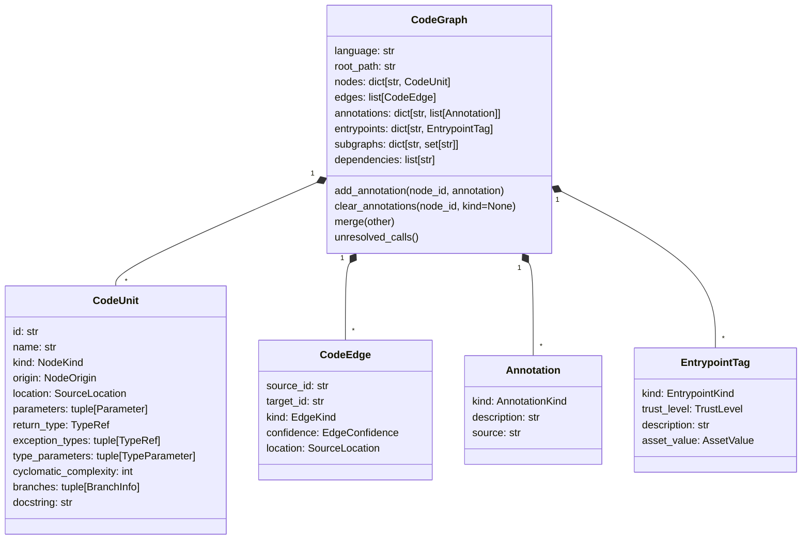

# Graph model

A `CodeGraph` holds nodes (`CodeUnit`), directed edges (`CodeEdge`),
annotations, entrypoint tags, named subgraphs, and the dependencies the parser
saw imported.

Nodes and edges also carry an `attributes` tuple of parser-specific key/value
pairs, such as Solidity visibility or the raw text of an unresolved call.

## Node kinds

| Kind | Used for |
| --- | --- |
| `function` | Free functions and other standalone callables, such as Miden procedures and Rego rules |
| `method` | Functions owned by a class, struct, trait, impl, contract, or service |
| `class` | Classes |
| `module` | Files, packages, and language modules |
| `struct` | Structs and records |
| `interface` | Interfaces, protocols, and ABI declarations |
| `trait` | Traits and type classes |
| `enum` | Enumerations |
| `namespace` | Namespaces and declared packages |
| `contract` | Smart contracts |
| `state_variable` | Persistent contract storage (Solidity) |
| `library` | Solidity libraries |
| `template` | Circom templates |
| `schema` | SQL schemas |
| `table` | SQL tables |
| `view` | SQL views |
| `procedure` | SQL procedures |
| `proxy` | Placeholders for unresolved or external call targets |

## Node origins

| Origin | Meaning |
| --- | --- |
| `source` | Parsed from a source file |
| `proxy` | Created for a call target that has no declaration in the graph |
| `binary` | Imported from an external binary-analysis graph |
| `synthetic` | Created by a parser for a construct with no named declaration, such as a Circom `component main` or a Miden Assembly `begin` block |

## Edge kinds

| Kind | From &rarr; to |
| --- | --- |
| `calls` | Caller &rarr; callee (or a proxy for it) |
| `reads` | Function, constructor, or modifier &rarr; state variable it reads (Solidity) |
| `writes` | Function, constructor, or modifier &rarr; state variable it writes (Solidity) |
| `inherits` | Subtype &rarr; base type |
| `implements` | Type &rarr; interface or trait it implements |
| `contains` | Owner &rarr; member (module &rarr; function, class &rarr; method, contract &rarr; state variable) |
| `imports` | Module &rarr; imported module. Only the Func, Move, Proto, Rego, Sway, Tact, and Thrift parsers emit these; other parsers record imported names in the graph's `dependencies` list instead. |
| `type_uses` | Function &rarr; type declaration named in its parameters, return type, exceptions, or generic bounds |
| `corresponds_to` | Source node &rarr; matching binary function, or SQL routine/view &rarr; object it depends on |
| `resolves_to` | Reserved; no built-in pass emits it, but `.trailmark/links.toml` may declare it |
| `specializes` | Reserved; no built-in pass emits it, but `.trailmark/links.toml` may declare it |

Reachability queries (`ancestors_of`, `reachable_from`, path queries) follow
only `calls` edges unless a method takes an `edge_kinds` argument.

## Edge confidence

| Confidence | Meaning |
| --- | --- |
| `certain` | Read directly from syntax |
| `inferred` | Bound by a heuristic, such as a unique name match across files, a call through a receiver, or a declared link |
| `uncertain` | Dynamic dispatch, an ambiguous target, or an overload that needs argument types |

Confidence records how the parser bound an edge, not whether its target was
found. An unresolved call through a receiver, such as `auth.verify()`, is
`inferred`, and an unresolved bare call such as `deny()` is `certain`. To find
unresolved calls, look for edges to `proxy.unresolved:` nodes or use
[`unresolved_calls()`](call-resolution.md) rather than filtering on
`uncertain`. `type_uses` edges are `certain` even though they come from name
matching.

## Node IDs

IDs have the form `module:function`, `module:Class`, or `module:Class.method`.

- **Module IDs** are root-relative dotted paths: `src/auth/token.py` becomes
  `src.auth.token`.
- **Colliding module IDs** include an escaped file extension. If `app.py` and
  `app.rs` both exist, their modules are `app\.py` and `app\.rs`. If `pkg.py`
  and `pkg/__init__.py` both exist, they are `pkg\.py` and `pkg.__init__\.py`.
  Module IDs that do not collide keep the plain form.
- **Nested declarations** include their owners: Java nested classes are
  `module:Outer.Inner`, and Solidity contract-level structs and enums are
  `module:Contract.Name`.
- **Overloads** in Solidity, C++, Java, C#, Kotlin, and Swift keep separate
  declarations and bodies. Colliding callable IDs gain an `@line_column` suffix,
  for example `token:Token.f@12_4`. When a type and a callable share an ID, the
  type keeps the base ID.
- **Rust local items** keep their enclosing function in the ID, and repeated
  local names gain a byte-offset suffix. See [Rust](languages.md#rust-and-verus).
- **Declared package and namespace IDs** (for example, Protobuf and Thrift
  packages) are not renamed. An unresolved collision between languages raises
  `ValueError` rather than merging unrelated nodes.

Position-based suffixes change when code above the declaration changes, so
`trailmark diff` reports the declaration as removed and added.

## Proxy nodes

A call whose target has no declaration in the graph becomes an edge to a proxy
node instead of being dropped:

- `proxy.unresolved:<raw-symbol>` for calls Trailmark could not resolve.
- `proxy.external:<name>` for endpoints declared external in
  `.trailmark/links.toml` and for calls out of an imported binary graph.

Proxies make the point where resolution stopped visible in traversals. Every
call site is still recorded separately, with its location; see
[Call resolution](call-resolution.md). When several graphs are merged, proxies
with the same identity are shared. If two different unresolved symbols escape
to the same `proxy.unresolved:` ID, or one collides with a real node, the
later proxy gains a hash suffix (`__<hash>`). Colliding `proxy.external:`
identities raise `ValueError` instead.

## Directory parsing

When parsing a directory:

- Walks skip dot directories, VCS and cache directories, `node_modules`,
  `vendor`, `venv`, `build`, and `dist`, and do not traverse directory
  symlinks. A directory named `lib` is included.
- Registered file-extension matching is case-insensitive for detection,
  directory parsing, and entrypoint dispatch. `.C` selects C, not C++. `.H`
  alone does not select a language. Single-file parsing accepts an explicit
  `language` that overrides detection.
- C and Objective-C both accept `.h`. When both are selected, headers use the
  Objective-C grammar, which also retains C declarations. Each physical header
  is parsed once. The C++ parser accepts `.hpp`, `.hh`, and `.hxx`, and does
  not walk `.h`.
- Explicit language lists ignore empty entries and remove duplicates, keeping
  first-occurrence order. At least one supported language is required.
- A package module in one language may span several files. Unexpected node-ID
  collisions across languages raise `ValueError` before merging.

## Cross-file resolution

After each file is parsed, Trailmark links the graph by name:

- Directory parsing resolves bare cross-file calls to a unique free-function
  candidate, with `inferred` confidence. Ambiguous cross-file calls stay
  unresolved. A free-function match never binds to an unrelated class method.
- Unqualified Solidity and C++ calls prefer a method in the caller's own
  container.
- Solidity calls can bind to a unique internally callable method through
  resolved inheritance edges, with `inferred` confidence. Inherited overloads
  and competing base methods stay unresolved. A missing external base does not
  discard a unique local or free-function match, but that match is `inferred`.
- `inherits` and `implements` edges link to unique type declarations within one
  language before entrypoint detection runs. These links are name-based and
  `inferred`.
- `type_uses` edges link type names to type declarations. They are linked
  within each language first; in a polyglot parse, a reference still unmatched
  after that can link to a same-named type in another language.
- Calls that need overload resolution stay unresolved and `uncertain`.
  Trailmark does not choose an overload by argument types.

Compiler-level import, receiver, and overload semantics are not modeled. See
[Language notes](languages.md) for per-language rules.
